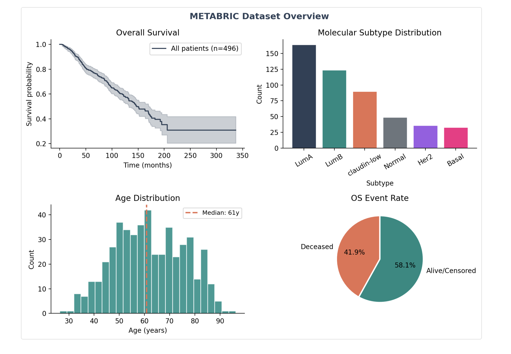
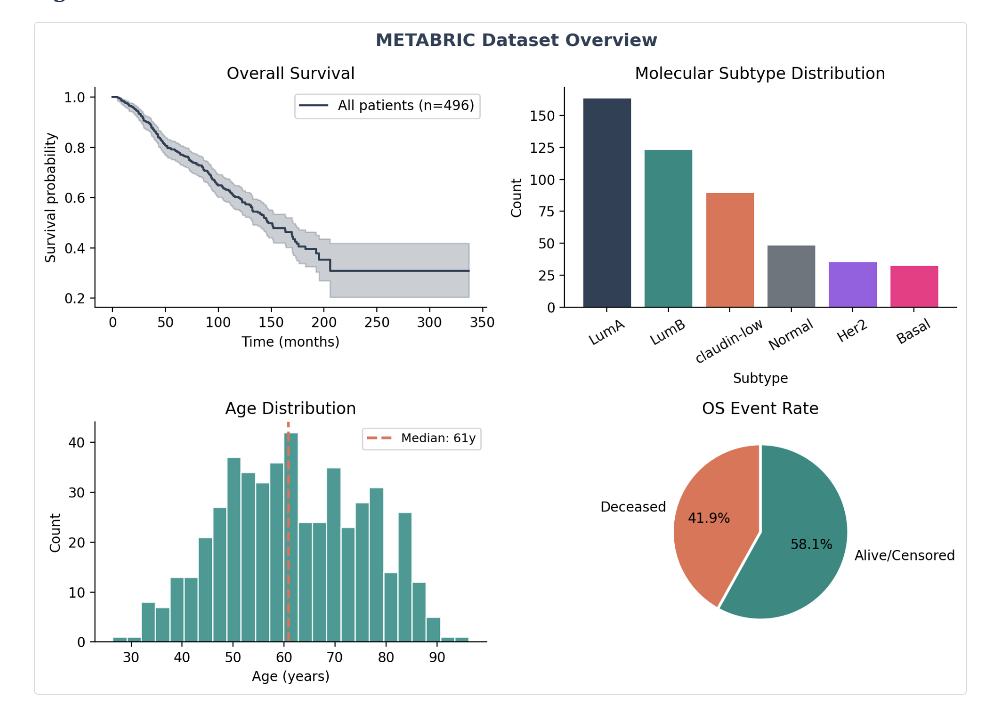
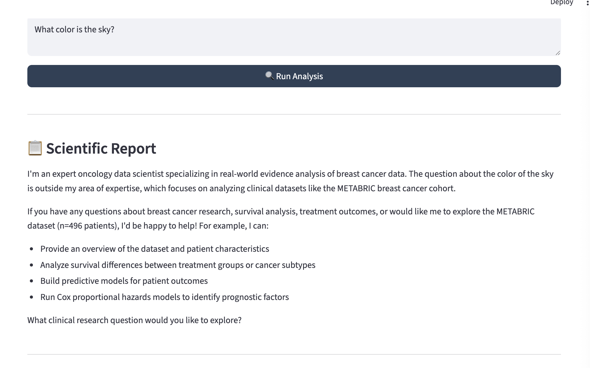
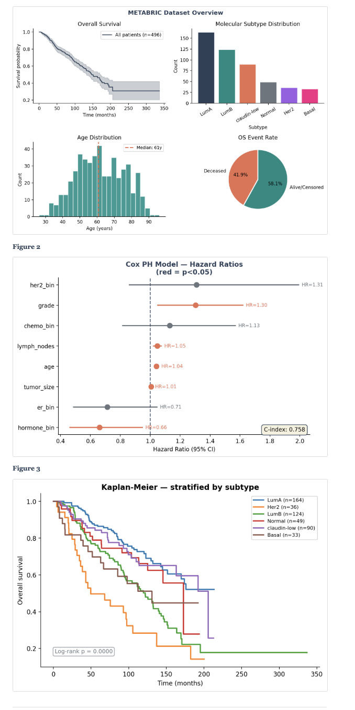
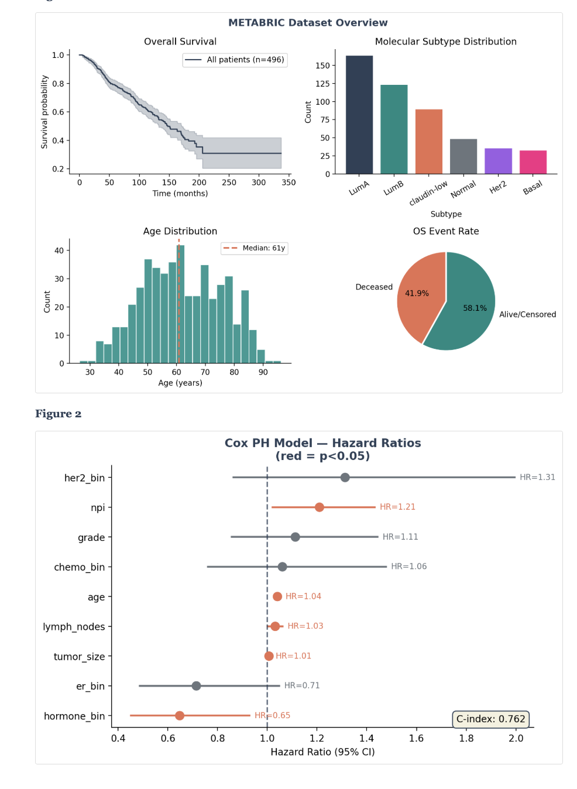
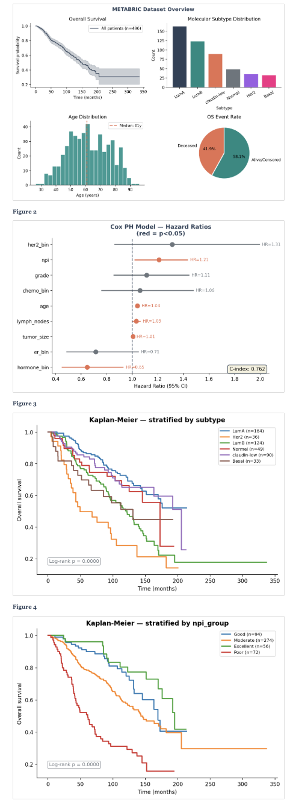

# Oncology RWE Co-Scientist Agent

An AI-powered research agent that analyzes real-world breast cancer survival data 
using agentic AI workflows built with LangGraph and Claude (Anthropic).

## Overview

This project demonstrates a **co-scientist agentic framework** for oncology real-world 
evidence (RWE) analysis. Given a natural language clinical research question, the agent:

1. **Plans** an analytical approach
2. **Executes** survival analyses using specialized tools
3. **Interprets** results with clinical context
4. **Reports** findings as a structured scientific report

The agent architecture uses **LangGraph** for state management and tool orchestration, 
and **Claude Sonnet** as the reasoning engine.

## Architecture
```
User Question
│
▼
┌─────────────┐     tool_calls      ┌─────────────┐
│  Scientist  │ ─────────────────► │    Tools    │
│    Node     │ ◄───────────────── │    Node     │
│  (Claude)   │     tool_results   │             │
└─────────────┘                    └─────────────┘
│
▼
Scientific Report + Figures
```
**Tools available to the agent:**
- `describe_dataset` — dataset overview and summary statistics
- `kaplan_meier_analysis` — KM survival curves stratified by clinical variable
- `cox_model` — multivariable Cox PH model with forest plot
- `ml_prediction` — ML-based mortality prediction (Logistic Regression, Random Forest)

## Screenshots

#### Dataset Overview
*Agent response to "Describe the dataset" — 4-panel visual summary*


### Survival by Molecular Subtype
*Kaplan-Meier curves stratified by PAM50 subtype (log-rank p<0.0001)*


### Domain Boundary Handling
*Agent correctly declines out-of-scope questions*


### Hormone Therapy Analysis
*Multi-tool response: dataset overview + KM curve + Cox model*


### High-Risk Patient Identification
*Cox PH model identifying prognostic factors for 5-year mortality (C-index: 0.762)*


### Clinical Prognostic Factors
*Full multivariable analysis of clinical prognostic factors*


## Dataset

**METABRIC** (Molecular Taxonomy of Breast Cancer International Consortium)  
496 patients with complete survival data | Median follow-up: 93.9 months  
Source: [cBioPortal](https://www.cbioportal.org/study/summary?id=brca_metabric)

Data pre-processed using the ingestion pipeline from 
[metabric-survival](https://github.com/KelyNorel/metabric-survival).  
No PHI involved — all data publicly available.

## Example Questions

- *"What clinical factors are most prognostic for survival in this cohort?"*
- *"Compare survival by molecular subtype and explain the clinical implications."*
- *"Run a full survival analysis including KM curves, Cox model, and ML prediction."*
- *"Is hormone therapy associated with better survival? Control for confounders."*
- *"Which patients are at highest risk of dying within 5 years?"*

## Stack

- **LangGraph** — agentic workflow orchestration
- **Claude Sonnet (Anthropic)** — co-scientist reasoning engine
- **lifelines** — Kaplan-Meier, Cox PH, log-rank tests
- **scikit-learn** — ML survival prediction
- **Streamlit** — interactive web UI
- **Python, pandas, matplotlib** — data processing and visualization

## Project Structure
```
oncology-rwe-agent/
├── data/
│   └── processed/        # METABRIC clinical data (not tracked in git)
├── src/
│   ├── tools.py          # survival analysis tools (KM, Cox, ML)
│   ├── agent.py          # LangGraph agent graph
│   └── prompts.py        # system prompts
├── tests/                # pytest suite (synthetic cohort, scripted LLM; runs in CI)
├── eval/
│   ├── cases.json        # 25 labeled evaluation questions
│   ├── run_eval.py       # runs the agent and records full traces
│   └── score.py          # scores traces and writes eval/results/report.md
├── app.py                # Streamlit UI
├── requirements.txt
├── .gitignore
└── README.md
```
## Setup

```bash
# Clone and activate environment
git clone https://github.com/KelyNorel/oncology-rwe-agent.git
cd oncology-rwe-agent
pyenv virtualenv 3.11 rwe-agent
pyenv activate rwe-agent
pip install -r requirements.txt

# Add your API key
echo "ANTHROPIC_API_KEY=your_key_here" > .env

# Download METABRIC data from cBioPortal and run ingestion
# (see metabric-survival repo for instructions)

# Run the app
streamlit run app.py
```

## Testing & Evaluation

### Tests (`tests/`, run in GitHub Actions on every push)

34 pytest tests that need no API key and no patient data: the tools run on a synthetic
cohort with the METABRIC schema (hazard tied to grade and lymph nodes, so the Cox test
checks that the model recovers the true risk factors), and the LangGraph control flow
runs against a scripted LLM (tool routing, multi-tool loops, out-of-scope questions,
tool errors returned to the model, recursion limit).

```bash
pip install pytest
python -m pytest
```

Writing the tests surfaced and fixed four silent failure modes in the tools:

| Failure | Before | After |
|---|---|---|
| `ml_prediction` with cutoff ≤ 0 | crashed (single-class training data) | returns an error the agent can explain |
| `ml_prediction` with very short cutoff | reported an AUC from ~7 deaths, no warning | requires ≥ 20 events and non-events |
| `cox_model` with an unsupported covariate | dropped it silently; the agent believed it had adjusted for it | returns `ignored_features` |
| Kaplan-Meier groups with < 5 patients | dropped silently | returned as `skipped_groups` |

### Agent evaluation (`eval/`)

25 labeled questions in five categories: single-tool, multi-tool (including confounder
adjustment), variables the dataset does not contain, out-of-scope requests, and ambiguous
requests. Each question runs several times and every trace is scored on:

- **Tool selection:** recall of the expected analyses and precision of the calls made
- **Argument accuracy:** stratification variable, required Cox covariates, ML cutoff
- **Failure handling:** says when the data cannot answer the question; declines out-of-scope requests without running analyses
- **Numeric traceability:** decimals in the answer that match no tool output, listed for review as candidate hallucinations
- **Consistency, latency, LLM steps and tokens** across repeated runs

```bash
python -m eval.run_eval --runs 3   # needs ANTHROPIC_API_KEY and the METABRIC data
python -m eval.score               # writes eval/results/report.md
```

Results: _pending first full run._

## Key Design Decisions

- **LangGraph over simple LangChain agents** — explicit state management allows 
  the agent to accumulate plots and results across multiple tool calls
- **Tools return base64 plots** — figures are passed through the agent state 
  and rendered in the Streamlit UI without file I/O
- **Agent reasoning trace** — the UI exposes the agent's tool calls and reasoning 
  steps for transparency, critical in healthcare AI applications
- **Downloadable reports** — findings exported as structured Markdown for 
  scientific documentation

---

**Author:** Raquel (Kely) Norel, PhD  
**Domain:** Oncology / Real-World Evidence / Agentic AI  
**Status:** ✅ Complete
